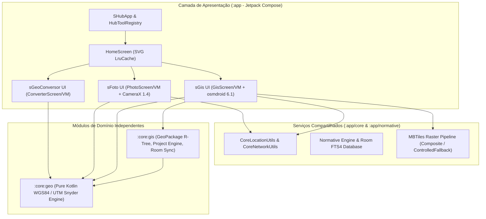

# Arquitetura do Sistema — sHub

**Data:** 2026-11-06  
**Autor:** Argon (Principal Software Architect & GIS Specialist)

---

## 1. Visão Geral

O **sHub** é uma plataforma modular Android de ferramentas de engenharia de campo (*field-first* / *100% offline-first*) projetada para operação em ambientes remotos da região Amazônica e Rondônia (inspeção de redes elétricas de Média e Baixa Tensão, subestações, georreferenciamento e registro fotográfico auditável).

---

## 2. Princípios Arquiteturais

1. **Operação 100% Offline (`OFFLINE_ONLY` por padrão):**
   - Nenhum fluxo crítico (conversão geodésica, captura de fotos/vídeos com carimbo técnico, renderização vetorial GeoPackage ou basemap satélite MBTiles) depende de conectividade de rede.
   - A geocodificação reversa de endereço no `sFoto` verifica explicitamente `CoreNetworkUtils.isNetworkAvailable()` antes de acionar o `Geocoder`, degradando graciosamente sem bloquear a captura.
   - No `sGis`, o modo padrão `GisNetworkMode.OFFLINE_ONLY` desativa conexões de dados no `MapView` (`setUseDataConnection(false)`).

2. **Separação Estrita entre Vetor e Raster:**
   - A rede elétrica oficial (postes, transformadores, chaves, vãos MT/BT, subestações) é mantida exclusivamente em camadas vetoriais **GeoPackage (`.gpkg`)** com índices espaciais SQLite R-Tree (`rtree_<tabela>_<coluna>`).
   - Imagens de satélite e mapas base residem exclusivamente em arquivos **MBTiles (`.mbtiles`)** gerenciados via `CompositeMbtilesArchive` e `ControlledFallbackArchive`.

3. **Desacoplamento Entre Ferramentas (`HubToolRegistry` & `core.location`):**
   - Os módulos de funcionalidade (`sGeoConversor`, `sFoto`, `sGis`, `normative`) não importam classes uns dos outros.
   - Utilitários transversais de localização e conectividade residem em `com.saile.shub.core.location` (`CoreLocationUtils`, `CoreNetworkUtils`).
   - O registro de ferramentas na tela inicial é orientado a metadados via `HubToolRegistry` (`HubToolDescriptor`), permitindo a adição de novos módulos (`sEletrica`, `sGPS`, `sInventario`, `sMedicao`, `sRelatorio`, `sInspecao`) sem acoplamento estrutural.

4. **Imutabilidade de Estado e Concorrência Segura:**
   - Todos os ViewModels expõem `StateFlow<UiState>` imutáveis consumidos via `collectAsStateWithLifecycle()`.
   - Todas as operações de banco de dados (Room, SQLite `PhotoPreferencesDbHelper`, `PhotoMediaMetadataDbHelper`, `GeoPackageReader`) e consultas ao `MediaStore` executam estritamente em `Dispatchers.IO` ou executores dedicados em background.
