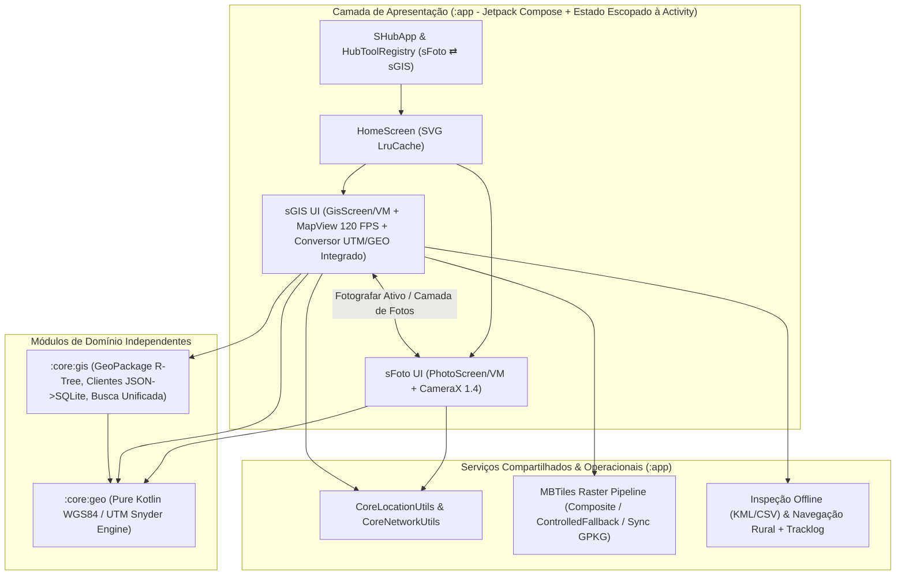

# Arquitetura do Sistema — sHub

**Data:** 2026-11-07  
**Autor:** Argon (Principal Software Architect & GIS Specialist)

---

## 1. Visão Geral

O **sHub** é uma plataforma modular Android de ferramentas de engenharia de campo (*field-first* / *100% offline-first*) projetada para operação em ambientes remotos da região Amazônica e Rondônia (inspeção de redes elétricas de Média e Baixa Tensão, subestações, atendimento comercial por UC/Medidor, georreferenciamento e registro fotográfico auditável).

O ecossistema concentra-se em dois módulos altamente integrados na Home: **`sFoto`** e **`sGIS`** (com o antigo `sGeoConversor` agora 100% integrado dentro do `sGIS`).

---

## 2. Princípios Arquiteturais

1. **Ecossistema Integrado e Preservação de Estado (`sGIS ⇄ sFoto`):**
   - `GisViewModel` e `PhotoViewModel` são escopados à Activity em `SHubApp.kt`, preservando a posição exata da câmera do mapa (`savedCenterLat`, `savedCenterLon`, `savedZoomLevel`) e o elemento selecionado ao alternar entre o `sGIS` e o `sFoto`.
   - Ao tocar em **"Fotografar sFoto"** no card de um ativo ou cliente no `sGIS`, o `PhotoViewModel` recebe automaticamente o carimbo técnico (`Código/UC/Medidor + Camada/Subtítulo`) e retorna diretamente ao `sGIS` após a captura.
   - As fotos georreferenciadas tiradas no `sFoto` (`PhotoMediaMetadataDbHelper`) são exibidas como camada interativa no mapa do `sGIS`.

2. **Renderização Vetorial a 120 FPS (Offscreen Bitmap Layer Caching):**
   - Em `GisVectorOverlay.kt`, os milhares de vãos MT/BT e símbolos elétricos do `.gpkg` são renderizados em um *Offscreen Bitmap Buffer* indexado pelo `BoundingBox`, nível de zoom e versão dos elementos, garantindo fluidez instantânea durante o arrasto do mapa.

3. **Busca Unificada (Rede `.gpkg` + Clientes `.json` + Coordenadas `GEO/DMS/UTM`):**
   - `GisClientsHelper.kt` converte arquivos `.json` de clientes (175.000+ UCs) via streaming (`JsonReader`) para um banco SQLite indexado (`gis_clients.db`), permitindo busca `< 1 ms` por **UC/CDC**, **Medidor** ou **Nome do Cliente** simultaneamente aos ativos `.gpkg` e coordenadas.
