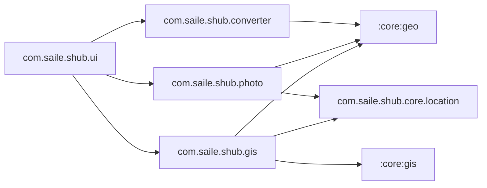

# Grafo de Dependências entre Módulos — sHub

**Data:** 2026-11-06

---

## 1. Estrutura Multi-Módulo Gradle (`settings.gradle.kts`)

| Módulo | Tipo | Namespace / Pacote | Dependências Internas | Responsabilidade |
|---|---|---|---|---|
| `:core:geo` | Biblioteca Kotlin JVM pura (`org.jetbrains.kotlin.jvm`) | `com.saile.shub.core.geo` | Nenhuma | Matemática geodésica WGS84 ↔ UTM (Snyder/Redfearn), conversão entre zonas UTM (`convertUtmZone`), bandas MGRS (`getUtmBand`) e formatação DMS. Zero dependência do Android SDK. |
| `:core:gis` | Biblioteca Android (`com.android.library`) | `com.saile.shub.gis` | `:core:geo` | Leitor nativo GeoPackage SQLite + R-Tree (`GpkgReader`), parser WKB (`WkbParser`), motor de projetos `.qgs` (`QgsXmlParser`, `ProjectManager`), sincronização offline (`SyncManager`, `SyncDatabase` via Room). |
| `:app` | Aplicação Android (`com.android.application`) | `com.saile.shub` | `:core:geo`, `:core:gis` | Shell da aplicação (`SHubApp`, `HomeScreen`, `HubToolRegistry`), utilitários de plataforma (`core.location`), `sGeoConversor`, `sFoto`, `sGis` (UI + MBTiles pipeline) e motor `normative`. |

---

## 2. Regras de Fronteira de Pacotes em `:app`

- **Regra Proibida:** Nenhum pacote de feature (`converter`, `photo`, `gis`, `normative`) pode importar diretamente classes de outro pacote de feature.
- **Violação Corrigida na Auditoria:** `com.saile.shub.gis.GisLocationTracker` importava `com.saile.shub.photo.location.LocationUtils`. A lógica compartilhada foi extraída para `com.saile.shub.core.location.CoreLocationUtils` e `CoreNetworkUtils`, eliminando 100% do acoplamento cruzado `sGis -> sFoto`.

---

## 3. Estratégia de Expansão Futura

Novos módulos de engenharia de campo devem seguir o padrão:
1. Domínio puro / cálculos matemáticos → módulo JVM ou Android Library em `:core:<dominio>` (ou `:feature:<modulo>`).
2. Registro declarativo no `HubToolRegistry` (`app/src/main/kotlin/com/saile/shub/ui/HubToolRegistry.kt`) via `HubToolDescriptor`:
   - `sEletrica`: Cálculos elétricos, queda de tensão, seleção de elos fusíveis e transformadores PBE (integrando `com.saile.shub.normative`).
   - `sGPS`: Diagnóstico GNSS, NMEA, precisão HDOP/VDOP e mock provider detector.
   - `sInventario`: Cadastro de ativos em campo sincronizado via `SyncManager`.
   - `sMedicao`: Medições topográficas de vãos e alturas.
   - `sRelatorio`: Exportação PDF/GeoJSON/CSV de inspeções.
   - `sInspecao`: Checklists normativos auditáveis com vínculo a fotos do `sFoto` e feições do `sGis`.

