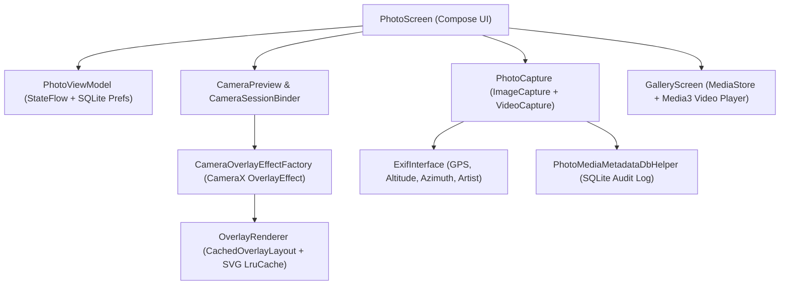

# Documentação Técnica do Módulo — sFoto

**Data:** 2026-11-06
**Pacote:** `com.saile.shub.photo` (`:app`)

---

## 1. Responsabilidade

O **sFoto** é a câmera técnica de inspeção de campo do **sHub**, projetada para capturar fotografias (disparo único ou contínuo *burst*) e vídeos MP4 com estampagem gráfica em tempo real de:
- Coordenadas UTM com zona e banda MGRS (`20L 401234 9031234`) via `:core:geo`;
- Coordenadas geográficas decimais (`7` casas decimais);
- Altitude ortométrica/elipsoidal e precisão horizontal (`± m`);
- Azimute magnético em graus e ponto cardeal (`N, NE, L, SE, S, SO, O, NO`);
- Data e hora sincronizadas (`dd/MM/yyyy HH:mm:ss`);
- Endereço reverso (quando houver conectividade, ocultado automaticamente em modo offline);
- Nome do operador/equipe e logotipo institucional vetorial SVG.

---

## 2. Arquitetura Interna

---

## 3. Garantias de Desempenho e Confiabilidade

1. **Zero Recomposições por Sensores/Relógio:** `LiveOverlaySensorState` armazena o azimute em campo `@Volatile` consumido diretamente pela thread de renderização do `OverlayEffect` sem disparar recomposições da UI Compose.
2. **Memoização de Layout a 60 FPS:** `OverlayRenderer` recalcula quebras de linha (`wrapText`) e dimensões da caixa apenas quando o texto (segundo do relógio, grau inteiro do azimute ou posição GPS) efetivamente muda (`CachedOverlayLayout`).
3. **Metadados Duplos (Visual + EXIF + SQLite):** Além do carimbo queimado na imagem, toda fotografia recebe tags EXIF padrão (`TAG_GPS_LATITUDE`, `TAG_GPS_LONGITUDE`, `TAG_GPS_ALTITUDE`, `TAG_GPS_IMG_DIRECTION`, `TAG_DATETIME_ORIGINAL`, `TAG_ARTIST`) e registro estruturado no banco SQLite local (`PhotoMediaMetadataDbHelper`).

